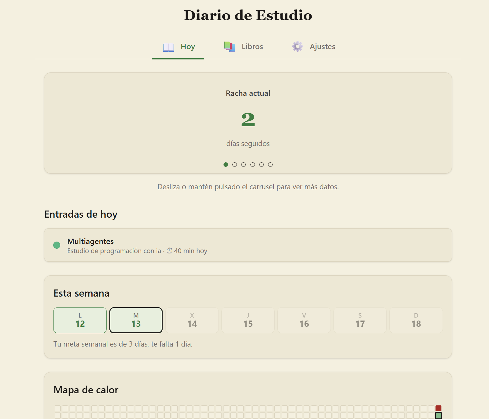
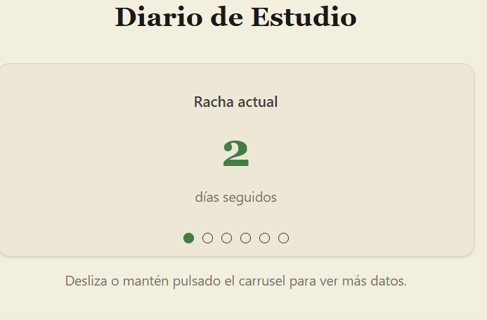
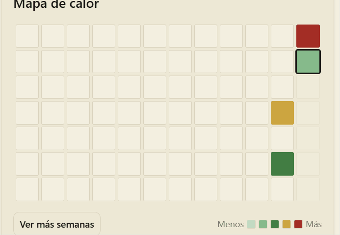
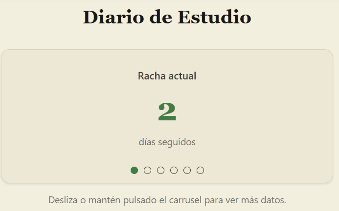

# 📖 Diario de Estudio

Registra tus sesiones de estudio y visualiza tu constancia: rachas, estadísticas y un mapa de calor de tus días estudiados. Funciona en el navegador, sin cuentas ni servidores.

<p align="center">  </p>

## ✨ Características

- **Registro de entradas** de estudio por libro, con fecha y minutos.
- **Pestaña Hoy**: carrusel de estadísticas, entradas del día y tira de la semana.
- **Racha diaria** y fuego 🔥 de semana perfecta.
- **Mapa de calor** tipo GitHub: cada día se colorea según los minutos estudiados.
- **Exportar e importar** tus datos en JSON.
- **Responsive** (desde 320 px) y con navegación por teclado.
- Interfaz en español.

## 📸 Capturas

| Hoy | Mapa de calor | Estadísticas |
|:---:|:---:|:---:|
|  |  |  |

## 🚀 Uso

1. Clona el repositorio:
   ```bash
   git clone https://github.com/MangoVerd3/Diario-de-estudio.git
   ```
2. Abre `index.html` en tu navegador. No hay dependencias ni paso de compilación.

Tus datos se guardan en el navegador (`localStorage`). Usa **Ajustes → Exportar** para hacer copias de seguridad.

## 🛠️ Tecnologías

HTML, CSS y JavaScript, sin frameworks. Tests con el ejecutor integrado de Node.js (18 o superior).

## ✅ Tests

Desde la raíz del proyecto:

```bash
node --test
```

## 🧭 Cómo está hecho

El proyecto se desarrolla con **Spec-Driven Development**: cada funcionalidad nace como una especificación en `specs/`, luego un plan y una lista de tareas, y se implementa con tests primero. Los principios del proyecto están en `docs/constitution.md`.

## 🗺️ Estado

- [x] Registro de entradas, racha diaria y estadísticas
- [x] Mapa de calor
- [x] Metas semanales y rachas semanales
- [ ] Mejorar estetica del apartado de libros

## 📄 Licencia

[MIT](LICENSE) · Hecho por Hector J.T.M.
